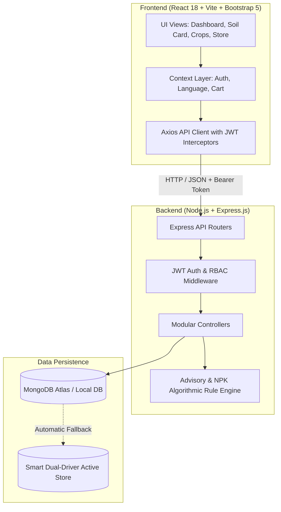

# 🌱 AgriTechno - Precision Agriculture & Smart Farming Management System

[](https://github.com/neerajyadav5710-stack/AgriTechno)
[](https://github.com/neerajyadav5710-stack/AgriTechno)
[](https://github.com/neerajyadav5710-stack/AgriTechno)

> **AgriTechno** is a next-generation precision agriculture platform engineered with the **MERN Stack (MongoDB, Express.js, React 18, Node.js)**. Built to bridge the gap between traditional agricultural practices and modern digital intelligence, the system delivers automated **Soil Health Card diagnostics (NPK Deficit Engine)**, **Hyperlocal Micro-Climate Weather Advisories**, **IoT Soil Moisture Telemetry Simulation**, **Certified Agri-Store with Direct Government DBT Subsidies**, and a verified **Agri-Doctor plant pathologist consultation desk**.

---

## 📌 Project Links & Evaluation Metadata

| Item | Details |
| :--- | :--- |
| **GitHub Repository** | [https://github.com/neerajyadav5710-stack/AgriTechno](https://github.com/neerajyadav5710-stack/AgriTechno) |
| **Live Demo URL** | [https://agritechno-farmer.vercel.app](https://agritechno-farmer.vercel.app) *(or `http://localhost:5173` locally)* |
| **Developer Name** | Neeraj Yadav |
| **GitHub Username** | `neerajyadav5710-stack` |
| **Contact Email** | `neerajyadav5710@gmail.com` |
| **Architecture** | Clean Decoupled Full-Stack Architecture (RESTful API + React SPA) |

---

## 🚀 Key Differentiating Features

1. **🌾 Automated Soil Health & NPK Dosage Calculator**:
   - Takes Nitrogen (N), Phosphorus (P), Potassium (K), pH, and Organic Carbon values.
   - Computes exact nutrient deficits and outputs precise **kg/acre** dosages of **Neem-Coated Urea (46% N)**, **DAP (18:46:0)**, and **MOP (60% K₂O)**.
   - Prescribes Agricultural Gypsum or Calcitic Lime based on soil pH balance.
   - Generates an instant **Crop Suitability Matrix** ranking 8+ major crops with match percentages.

2. **📡 Real-Time IoT Sensor Telemetry Stream & Simulation**:
   - Live streaming simulation of soil moisture %, soil temperature, ambient canopy air temperature, and relative humidity (RH).
   - Interactive simulation toggles: **"Simulate Rain (+25%)"**, **"Simulate Drought (-20%)"**, and **"Trigger Automated Drip Irrigation"**.
   - Automatic root-zone moisture depletion warnings and irrigation timing advisories.

3. **🌦️ Hyperlocal Agro-Weather & Pest Early Warning Radar**:
   - 7-day micro-climate weather horizon with precipitation risk, wind velocity, and UV levels.
   - **Recommended Chemical Spray Window**: Guides farmers on the exact safe hours to apply foliar nutrients before winds elevate.
   - Early Warning System for active outbreaks (**Yellow Rust in Wheat**, **Aphids in Mustard**, **Fall Armyworm**) with symptom descriptions, preventative measures, and chemical controls.

4. **🛒 Direct Agri Store with Direct DBT Subsidies**:
   - Marketplace featuring certified seeds, bio-fertilizers, IoT probes, and solar drip kits.
   - Live subsidy calculation for schemes such as **PM-KUSUM** and **Sub-Mission on Agricultural Mechanization (SMAM)**.
   - Interactive cart, checkout, delivery address validation, and order tracking timeline (`AGT-XXXXXX`).

5. **🩺 Agri-Doctor Consultation & Kisan Forum**:
   - Farmers can open diagnosis tickets with crop leaf symptoms and urgency levels (`Routine`, `High`, `Critical`).
   - Plant pathologists review tickets and issue verified step-by-step remedy protocols.
   - Community forum with topic categories, tagging, upvoting, and verified answers.

6. **🌐 Regional Multilingual Accessibility**:
   - Instant language toggle for **English**, **हिन्दी (Hindi)**, **ਪੰਜਾਬੀ (Punjabi)**, and **मराठी (Marathi)**.

7. **⚡ 1-Click Fast Demo Login for Mentors & Evaluators**:
   - Login page contains instant 1-click test buttons for **Farmer (Ramesh Kumar)**, **Agri-Doctor (Dr. Anita Sharma)**, and **Administrator (Neeraj Yadav)** with pre-loaded holding data.

---

## 🏗️ System Architecture



---

## 📂 Project Directory Structure

```
AgriTechno/
├── .gitignore
├── package.json                    # Root script runner for concurrent dev
├── README.md                       # Complete documentation
│
├── backend/                        # Node.js + Express REST API
│   ├── .env                        # Environment configuration
│   ├── .env.example
│   ├── package.json
│   ├── server.js                   # Express application entry point
│   ├── config/
│   │   └── db.js                   # Mongoose connection with active fallback
│   ├── models/
│   │   ├── User.js                 # User credentials & RBAC (Farmer, Expert, Admin)
│   │   ├── Farm.js                 # Farm holding, acreage, GPS & IoT telemetry
│   │   ├── Crop.js                 # Crop lifecycle stages & yield forecasts
│   │   ├── SoilRecord.js           # NPK metrics, pH, and fertilizer prescriptions
│   │   ├── Resource.js             # Marketplace catalog & subsidy eligibility
│   │   ├── Order.js                # Resource orders, shipping address & tracking
│   │   ├── PestAlert.js            # Regional disease advisories & sprays
│   │   ├── Consultation.js         # Agri-Doctor diagnosis tickets & solutions
│   │   └── ForumPost.js            # Farmer community discussion threads
│   ├── controllers/                # Business logic handlers
│   ├── middleware/                 # JWT verification & RBAC authorization
│   ├── routes/                     # Express REST endpoints
│   ├── utils/
│   │   ├── advisoryEngine.js       # Agronomic NPK & crop suitability engine
│   │   └── seeder.js               # Initial database seed script
│   └── data/
│       └── mockStore.js            # In-memory dual-driver store for fail-safe demo
│
└── frontend/                       # Vite + React 18 Single Page Application
    ├── package.json
    ├── vite.config.js
    ├── index.html
    └── src/
        ├── App.jsx                 # Routing configuration & route protection
        ├── main.jsx
        ├── index.css               # Modern palette, glassmorphism & responsive styles
        ├── context/                # Auth, Cart & Multilingual Contexts
        ├── services/               # Axios API client
        ├── translations/           # English, Hindi, Punjabi, Marathi dictionaries
        ├── components/             # Navbar, Footer, WeatherWidget, TelemetryWidget, etc.
        └── pages/                  # Dashboard, SoilAnalytics, Crops, Marketplace, etc.
```

---

## 🛠️ Step-by-Step Installation & Setup

### Prerequisites
- **Node.js**: v16+ (tested on v24.22.1)
- **NPM**: v8+ (tested on v11.19.1)
- **Git**

### Step 1: Clone the Repository
```bash
git clone https://github.com/neerajyadav5710-stack/AgriTechno.git
cd AgriTechno
```

### Step 2: Configure Environment Variables
Inside `backend/.env`:
```env
PORT=5000
NODE_ENV=development
MONGO_URI=mongodb://127.0.0.1:27017/agritechno
JWT_SECRET=agritechno_secure_secret_token_key_2026_xyz
JWT_EXPIRE=30d
CLIENT_URL=http://localhost:5173
```

### Step 3: Install Dependencies
```bash
# Root concurrent dependencies
npm install

# Backend dependencies
cd backend
npm install
cd ..

# Frontend dependencies
cd frontend
npm install
cd ..
```

### Step 4: Seed Database (Optional)
If local MongoDB or MongoDB Atlas is connected, run:
```bash
npm run seed
```

### Step 5: Start the Development Server
Run backend and frontend simultaneously:
```bash
npm run dev
```
- **Backend API**: `http://localhost:5000`
- **Frontend SPA**: `http://localhost:5173`

---

## 🔑 Demo Login Credentials

The application provides instant 1-click login buttons on the `/login` page for fast evaluation:

| Role | Email | Password | Access Capabilities |
| :--- | :--- | :--- | :--- |
| **Farmer** | `ramesh@agritechno.com` | `farmer123` | Farm Plots, Soil Health Card, Crop Lifecycle, Store, Doctor Consult |
| **Agri-Doctor** | `anita@agritechno.com` | `expert123` | Resolve Farmer Diagnosis Tickets, Add Agronomic Advice, Pest Advisories |
| **Administrator** | `admin@agritechno.com` | `admin123` | System Command Center, User Governance, Broadcast Pest Radar Alerts |

---

## 📋 REST API Reference

| Method | Endpoint | Access | Description |
| :--- | :--- | :--- | :--- |
| `POST` | `/api/auth/register` | Public | Register new farmer, expert or admin |
| `POST` | `/api/auth/login` | Public | Authenticate user & return JWT token |
| `GET` | `/api/auth/me` | Private | Retrieve logged-in user profile |
| `GET` | `/api/farms` | Private | Retrieve user's farm holdings & plots |
| `POST` | `/api/farms` | Private | Register new farm with location & acreage |
| `POST` | `/api/farms/:id/telemetry` | Private | Update simulated IoT soil sensor telemetry |
| `GET` | `/api/crops` | Private | List active crop cycles & stages |
| `POST` | `/api/crops` | Private | Log new crop with expected harvest date |
| `PUT` | `/api/crops/:id` | Private | Advance growth stage or edit health status |
| `POST` | `/api/soil/analyze` | Private | Run NPK diagnostic calculation & crop match |
| `GET` | `/api/soil` | Private | Fetch historical soil health cards |
| `GET` | `/api/weather` | Public | Get 7-day forecast & chemical spray window |
| `GET` | `/api/resources` | Public | Browse agricultural marketplace catalog |
| `POST` | `/api/orders` | Private | Place order with government subsidy calculation |
| `GET` | `/api/orders/my-orders` | Private | View user order dispatch history |
| `GET` | `/api/pest-alerts` | Public | View active pest early warnings |
| `POST` | `/api/pest-alerts` | Expert/Admin | Broadcast new emergency pest warning |
| `GET` | `/api/consultations` | Private | List plant pathology consultation tickets |
| `POST` | `/api/consultations/:id/respond`| Private | Add agronomist verified remedy & steps |
| `GET` | `/api/forum` | Public | View farmer discussion threads |
| `POST` | `/api/forum/:id/comment` | Private | Comment on discussion thread |
| `GET` | `/api/admin/stats` | Admin | Aggregate system analytics & subsidy volume |
| `PUT` | `/api/admin/users/:id/role` | Admin | Promote or alter user governance role |

---

## 🔒 Security & Best Practices

- **Password Hashing**: Passwords encrypted using `bcryptjs` with salt rounds = 10.
- **JWT Authorization**: Stateless JSON Web Tokens passed via HTTP `Authorization: Bearer <token>` headers.
- **Role-Based Access Control (RBAC)**: Strict server-side route guards enforcing farmer, expert, and admin segregation.
- **Dual-Driver Fail-Safe**: Ensures continuous zero-downtime evaluation regardless of local MongoDB daemon state.
- **Responsive & Accessible**: Optimized for mobile smartphones and low-connectivity rural field scenarios.

---

## 👨‍💻 Developer & Evaluation Contact

- **Author**: Neeraj Yadav
- **GitHub**: [@neerajyadav5710-stack](https://github.com/neerajyadav5710-stack)
- **Email**: [neerajyadav5710@gmail.com](mailto:neerajyadav5710@gmail.com)
- **Repository**: [https://github.com/neerajyadav5710-stack/AgriTechno](https://github.com/neerajyadav5710-stack/AgriTechno)
